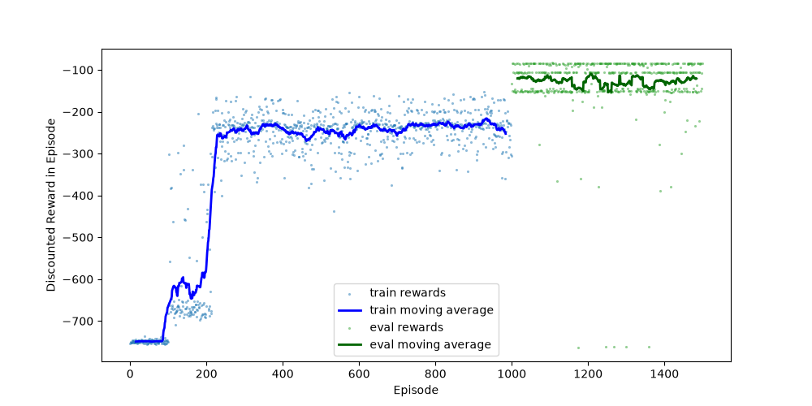
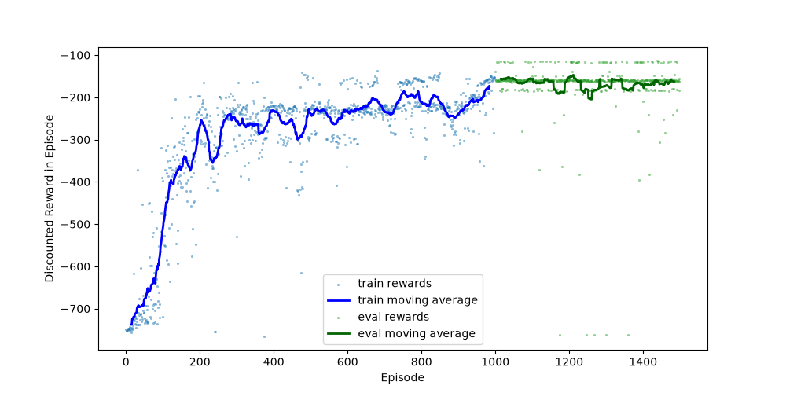
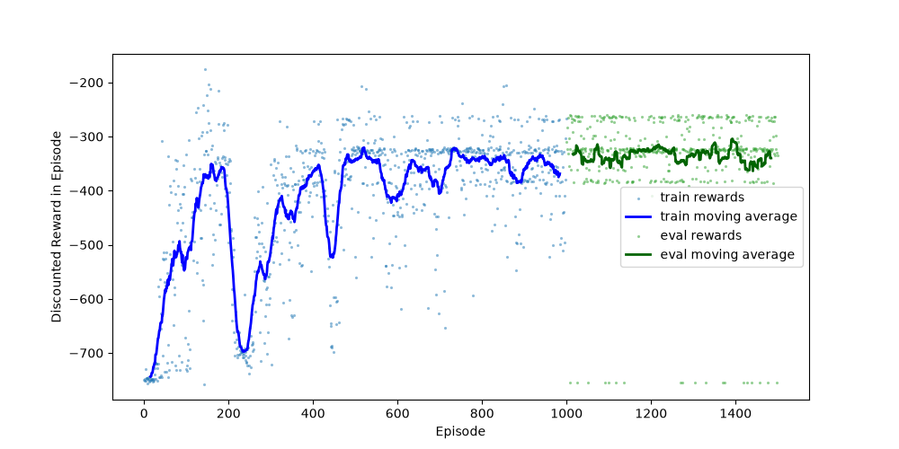

# CS221 Homework 4: Mountain Car

## Problem 1: Value iteration

Using

\[
Q_i(s,a)=\sum_{s'}T(s'|s,a)
  \left(\operatorname{Reward}(s,a,s')+\gamma V_{i-1}(s')\right),
\qquad \gamma=1,
\]

the values are:

| State | \(V^\star_1(s)\) | \(V^\star_2(s)\) |
|---:|---:|---:|
| -2 | 0 | 0 |
| -1 | 7 | 6 |
| 0 | -5 | 3.35 |
| +1 | 11.5 | 8 |
| +2 | 0 | 0 |

For \(V^\star_2\), the optimal policy is:

\[
\pi^\star(-1)=a_1,\qquad
\pi^\star(0)=a_2,\qquad
\pi^\star(+1)=a_2.
\]

## Problem 2: Transforming MDPs

Add an absorbing state \(o\). For each original state \(s\), action \(a\), and
original next state \(s'\), define

\[
T'(s'|s,a)=\gamma T(s'|s,a),\qquad
T'(o|s,a)=1-\gamma.
\]

Set

\[
\operatorname{Reward}'(s,a,s')=
\frac{\operatorname{Reward}(s,a,s')}{\gamma},
\qquad
\operatorname{Reward}'(s,a,o)=0,
\]

and make \(o\) absorbing with zero reward. The transformed MDP has discount
factor \(1\). Its Bellman recurrence is

\[
\begin{aligned}
V'(s)
&=\max_a\sum_{s'}\gamma T(s'|s,a)
 \left(\frac{R(s,a,s')}{\gamma}+V'(s')\right)\\
&=\max_a\sum_{s'}T(s'|s,a)
 \left(R(s,a,s')+\gamma V'(s')\right).
\end{aligned}
\]

This is exactly the original discounted Bellman recurrence, so the optimal
values agree for every original state: \(V'(s)=V_{\mathrm{opt}}(s)\).

## Problem 3: Value iteration on Mountain Car

The implementation is in [`submission.py`](./submission.py). Model-based value
iteration can improve after it has collected enough transition samples, but
the early training curve is noisy because the estimated model is based on
limited data. It can perform poorly when the state space is large, important
states are rarely visited, the transition model is estimated from biased
exploration, or the model is updated too infrequently.

The generated training plots are [`mcvi_1.png`](./mcvi_1.png),
[`mcvi_2.png`](./mcvi_2.png), and [`mcvi_3.png`](./mcvi_3.png).

## Problem 4: Q-learning

### 4a--4c

The implementations of tabular Q-learning, Fourier features, and
function-approximation Q-learning are in [`submission.py`](./submission.py).

The tabular agent generally performs better on this task because the
discretized state space is small enough to visit repeatedly, allowing each
state-action value to be learned directly. Function approximation shares
information between nearby continuous states, but a single set of linear
weights can underfit the nonlinear Mountain Car dynamics and updates can
interfere across states.

The generated plots are:

- [`tabular_1.png`](./tabular_1.png), [`tabular_2.png`](./tabular_2.png),
  [`tabular_3.png`](./tabular_3.png)
- [`fapprox_1.png`](./fapprox_1.png), [`fapprox_2.png`](./fapprox_2.png),
  [`fapprox_3.png`](./fapprox_3.png)

Function approximation can outperform tabular Q-learning when exploration is
limited, the state space is very high-dimensional, or memory is constrained.
It generalizes from visited states to similar unseen states instead of storing
an independent value for every state-action pair.

## Problem 5: Safe exploration

### 5a

`self.max_speed` clips the next velocity to the interval
\([-\,\texttt{max_speed},\texttt{max_speed}]\) after the physics update and
before the next position is computed.

### 5b

Removing the velocity limit does not necessarily change the learned policy
because the agent's observations and reward still favor building momentum and
reaching the goal. If the unconstrained trajectories rarely need velocities
above the original limit, the constraint is not active often enough to change
the learned action preferences.

### 5c

`ConstrainedQLearning` predicts

\[
v_{t+1}=v_t+(a-1)\cdot\texttt{force}
-\cos(3p_t)\cdot\texttt{gravity}
\]

and removes an action when \(v_{t+1}\) is not less than
`velocity_threshold`. It returns `None` when no action is valid. The two
policies differ because the constrained agent cannot select actions that would
cross the safety threshold, whereas the unconstrained agent can use those
actions to build additional momentum.

The helper comparison was run successfully with `max_speed=10000` and
`max_speed=0.065`.

### 5d: Autonomous-vehicle MDPs

#### MDP A: unconstrained public-road learning

- **States:** \(s=(x,y,v,\ell,p,r,\tau)\), where \((x,y)\) is position,
  \(v\) is speed, \(\ell\) contains lane and traffic-light status, \(p\)
  contains detected pedestrians and nearby vehicles, \(r\) contains the
  road speed limit, and \(\tau\) is the time step.
- **Actions:** steering, acceleration, braking, and lane-change commands,
  with all physically available commands allowed in every state.
- **Reward:**
  \[
  R(s,a,s')=c_{\mathrm{progress}}\Delta d
  -c_{\mathrm{time}}
  -c_{\mathrm{comfort}}|\Delta a|
  -c_{\mathrm{collision}}\mathbf{1}_{\mathrm{collision}}
  -c_{\mathrm{traffic}}\mathbf{1}_{\mathrm{violation}}.
  \]
  If the collision penalty is too small relative to progress, exploration can
  still favor risky behavior.
- **Exploration:** epsilon-greedy actions directly on public roads, with
  epsilon gradually decaying.

This design can harm pedestrians and other road users because trial-and-error
actions occur in the real environment and the reward may not fully represent
the severity of rare collisions.

#### MDP B: constrained and staged learning

- **States:** the same state representation as MDP A, augmented with
  uncertainty estimates for perception and localization.
- **Actions:** the same nominal controls, but the available action set is
  filtered by a safety controller. It removes actions that exceed speed
  limits, violate red lights, enter pedestrian safety zones, or exceed
  braking and steering bounds.
- **Reward:**
  \[
  R(s,a,s')=c_{\mathrm{progress}}\Delta d
  -c_{\mathrm{time}}
  -c_{\mathrm{comfort}}|\Delta a|
  -C_{\mathrm{collision}}\mathbf{1}_{\mathrm{collision}}
  -C_{\mathrm{violation}}\mathbf{1}_{\mathrm{violation}}
  -C_{\mathrm{uncertainty}}\mathbf{1}_{\mathrm{unsafe\ uncertainty}},
  \]
  where \(C_{\mathrm{collision}}\) and \(C_{\mathrm{violation}}\) dominate all
  progress rewards.
- **Exploration:** train first in simulation and closed courses using
  randomized scenarios, then use a conservative uncertainty-aware policy on
  public roads. Unsafe actions are rejected and a verified fallback policy
  performs a controlled stop when no action passes the safety filter.

This design reduces harm by preventing known unsafe controls and by keeping
high-risk exploration away from pedestrians and public traffic. It does not
eliminate all risk, so monitoring, testing, and human override remain
necessary.
